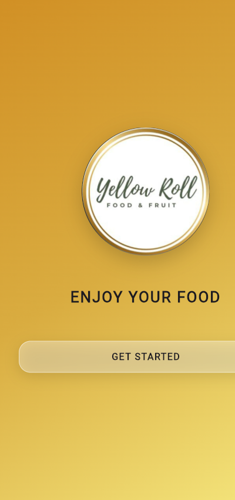
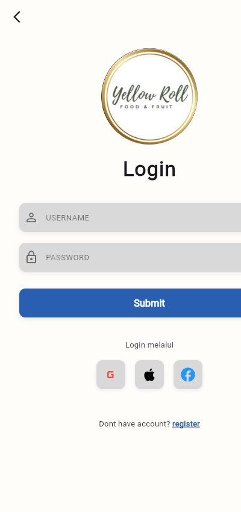
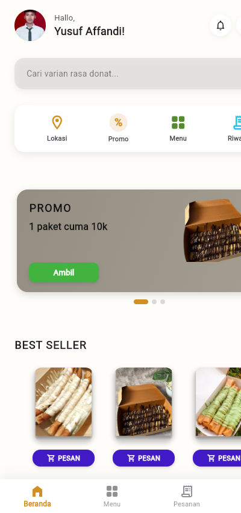
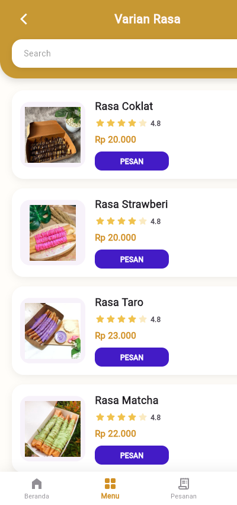
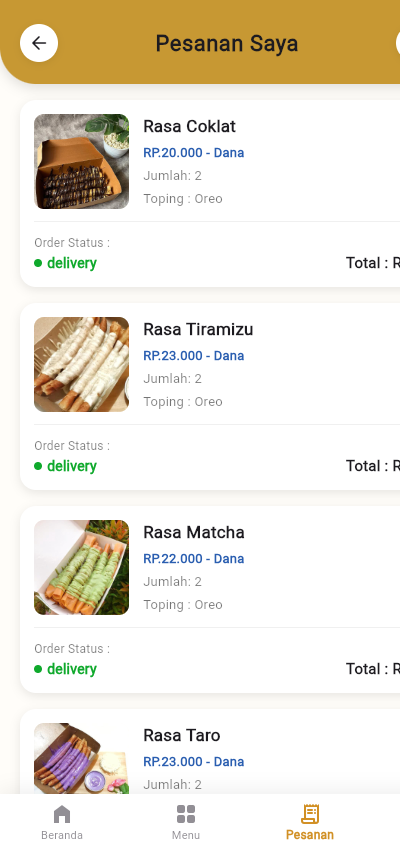
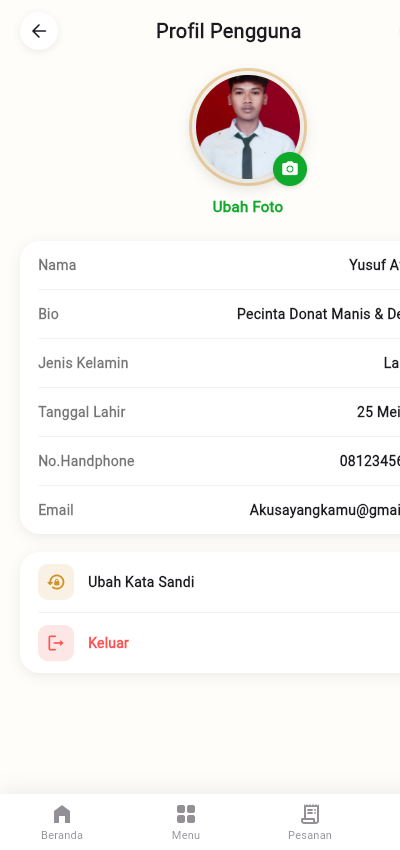

# LAPORAN PENJELASAN APLIKASI MOBILE PROGRAMMING
### UJIAN TENGAH SEMESTER (UTS) GASAL TAHUN AKADEMIK 2026/2027
**Fakultas Teknik dan Informatika - Universitas PGRI Semarang**

---

### Data Mahasiswa & Mata Kuliah
- **Nama Mahasiswa**: Muhammad Yusuf Affandi
- **NIM**: 24670009
- **Program Studi / Kelas**: Informatika / Semester V / Kelas A/F
- **Mata Kuliah / SKS**: Mobile Programming (3 SKS)
- **Dosen Pengampu**: Aris Tri Joko Harjanto, S.Kom., M.Kom.
- **Hari, Tanggal**: Kamis, 29 Oktober 2026
- **Repository GitHub**: [https://github.com/affandi25/UTS_Mobile_programing_24670009](https://github.com/affandi25/UTS_Mobile_programing_24670009)

---

## 1. NAMA DAN TUJUAN APLIKASI

### 1.1. Nama Aplikasi
Aplikasi yang dibangun bernama **"Sweet Dessert & Donut App" (SweetBite Mobile)**. Aplikasi ini merupakan implementasi sistem antarmuka pemesanan makanan/dessert manis berbasis **Flutter**, yang memfokuskan layanan pada olahan donat gulung dengan beragam varian rasa dan topping premium.

### 1.2. Latar Belakang & Tujuan
1. **Digitalisasi Layanan Kuliner (F&B)**: Memudahkan pengguna (mahasiswa dan masyarakat umum) dalam menjelajahi katalog menu donat, mengecek promo kupon diskon, memilih topping, serta melakukan pemesanan langsung dari smartphone secara praktis.
2. **Pengalaman Pengguna Interaktif (UI/UX)**: Menyajikan antarmuka visual yang modern, responsif, dan estetik dengan nuansa keemasan (*warm gold*) dan aksen navy yang elegan sesuai standar e-commerce masa kini.
3. **Penerapan Capaian Pembelajaran Mobile Programming**: Mengimplementasikan materi kuliah Flutter secara komprehensif, mencakup UI Dasar, tata letak hierarkis (Row & Column), Spacing presisi, penanganan gambar lokal & BoxFit, serta manajemen navigasi multi-halaman berbasis tumpukan riwayat (LIFO Stack) menggunakan `Navigator.push()` dan `Navigator.pop()`.

---

## 2. PENJELASAN FITUR-FITUR APLIKASI

| No | Fitur Utama | Halaman & File Dart | Fungsi & Perilaku Interaktif |
|---|---|---|---|
| 1 | **Onboarding Screen** | `OnboardingScreen`<br>(`lib/screens/onboarding/onboarding_screen.dart`) | Menyambut pengguna baru dengan latar gradien emas (#D4A017), logo lingkaran donat, tagline *"ENJOY YOUR FOOD"*, dan tombol *"GET STARTED"* menuju halaman login. |
| 2 | **Autentikasi Pengguna** | `LoginScreen` & `RegisterScreen`<br>(`lib/screens/auth/login_screen.dart`) | Form input Username & Password dengan toggle visibility, tombol Submit Navy (#2A5EB0), opsi social login (Google, Apple, Facebook), serta navigasi silang antara Login dan Registrasi. |
| 3 | **Dashboard Beranda** | `HomeScreen`<br>(`lib/screens/home/home_screen.dart`) | Pusat aktivitas utama: Personalized Header sapaan *"Hallo, Yusuf Affandi!"*, foto profil asli mahasiswa, Live Search Bar, Quick Action Bar, Banner Carousel promo diskon, daftar Donat Best Seller, dan Bottom Navigation Bar. |
| 4 | **Katalog Varian Rasa** | `MenuCatalogScreen`<br>(`lib/screens/menu/menu_catalog_screen.dart`) | Menampilkan 6 katalog varian donat gulung (Coklat, Strawberry, Taro, Matcha, Tiramisu, Mix Rasa) dilengkapi live search filter real-time, rating 4.8 bintang, harga transparan, dan tombol pesan langsung. |
| 5 | **Detail & Pesanan Saya** | `MyOrderScreen`<br>(`lib/screens/order/my_order_screen.dart`) | Layar detail untuk kustomisasi pesanan sebelum checkout: thumbnail donat terpilih, selector topping tambahan (Oreo, Keju, Chocochip), counter kuantitas (+/-), integrasi dompet digital DANA resmi, status delivery, dan rincian total pembayaran. |
| 6 | **Profil Mahasiswa** | `ProfileScreen`<br>(`lib/screens/profile/profile_screen.dart`) | Menampilkan identitas pengembang aplikasi (Muhammad Yusuf Affandi, NIM 24670009, Informatika UPGRIS), avatar foto profil mahasiswa asli, pengaturan akun, dan tombol *"Keluar"* (Logout) yang membersihkan tumpukan riwayat rute. |

---

## 3. PENJELASAN WIDGET DAN MATERI FLUTTER YANG DITERAPKAN

Sesuai ketentuan soal ujian, seluruh komponen materi Flutter telah diimplementasikan secara komprehensif pada struktur kode:

### 3.1. UI Dasar Flutter (Text, TextStyle, Icon, Color, Container)
- **Text & TextStyle**: Mengatur ukuran teks (`fontSize`), ketebalan (`fontWeight: FontWeight.bold / FontWeight.w900`), jarak antar huruf (`letterSpacing: 2.0`), perataan teks (`textAlign`), serta pewarnaan font.
- **Icon**: Memanfaatkan pustaka Material Icons komunikatif: `Icons.home_filled`, `Icons.grid_view_rounded`, `Icons.receipt_long_rounded`, `Icons.person_outline_rounded`, `Icons.search`, `Icons.star_rounded`, `Icons.lock_outline`.
- **Color**: Terpusat pada `lib/core/app_colors.dart` untuk menjaga konsistensi: Primary Gold (`#D4A017`), Navy Button (`#2A5EB0`), Background Light (`#FDFBF7`), Gray Input (`#F1F3F6`), dan Dark Text (`#1E2022`).
- **Container**: Pembungkus fleksibel dengan dekorasi tingkat lanjut (`BoxDecoration`), sudut melengkung (`borderRadius`), efek bayangan (`boxShadow`), border garis, dan efek latar gradien (`LinearGradient`).

### 3.2. Layouting (Row, Column, dan Kombinasi Keduanya)
- **Column**: Menyusun elemen secara vertikal dari atas ke bawah, seperti input form pada login dan seksi-seksi di beranda.
- **Row**: Menyusun elemen secara horizontal dari kiri ke kanan, seperti header profil & notifikasi, rating bintang & nominal harga, serta tombol kuantitas `[-] [+]`.
- **Kombinasi Row & Column**: Diterapkan pada kartu donat Best Seller dan kartu Menu Katalog (kartu induk menggunakan `Row` untuk gambar di kiri dan kolom detail di kanan; kolom detail disusun menggunakan `Column` dari nama &rarr; rating &rarr; harga &rarr; tombol pesan).

### 3.3. Spacing (Margin, Padding, dan SizedBox)
- **Margin**: Memberikan jarak luar antar elemen kartu (`EdgeInsets.symmetric(horizontal: 16, vertical: 8)`).
- **Padding**: Memberikan jarak bagian dalam antara konten dengan tepi kontainer (`EdgeInsets.symmetric(horizontal: 32.0)`).
- **SizedBox**: Memberikan pemisah jarak statis yang efisien (`SizedBox(height: 18)` untuk jarak vertikal antar form input, dan `SizedBox(width: 12)` untuk pemisah horizontal).

### 3.4. Pengelolaan Gambar (Image.asset, Ukuran, dan BoxFit)
- **Image.asset()**: Memanggil aset lokal berkualitas tinggi dari folder `asset/` yang didaftarkan pada `pubspec.yaml`.
- **BoxFit.cover**: Memastikan gambar pada kartu donat dan foto profil mahasiswa mengisi area container secara proporsional tanpa ruang kosong.
- **BoxFit.contain**: Menjaga proporsi logo onboarding donat agar tampil utuh tanpa terpotong.
- **ClipRRect & ClipOval**: Memotong sudut gambar donat dengan radius melengkung halus (`BorderRadius.circular(16)`) dan membuat avatar mahasiswa menjadi lingkaran sempurna.

### 3.5. Manajemen Navigasi Multi-Halaman (Navigator.push & Navigator.pop)
Aplikasi mengintegrasikan **7 halaman lengkap** (melebihi syarat minimal 5 halaman pada soal UTS) dengan konsep tumpukan riwayat LIFO Stack:
- `Navigator.push()`: Menumpuk halaman baru ke atas riwayat navigasi.
- `Navigator.pop()`: Mengeluarkan halaman teratas saat tombol panah kembali diklik untuk kembali ke halaman sebelumnya secara berurutan.
- `Navigator.popUntil()`: Membersihkan seluruh tumpukan halaman dan langsung kembali ke Beranda utama saat tab Beranda ditekan.
- `Navigator.pushReplacement()` & `Navigator.pushAndRemoveUntil()`: Digunakan pada alur Get Started, Login, dan Logout untuk mereset riwayat navigasi secara bersih.

---

## 4. SCREENSHOT TAMPILAN APLIKASI LENGKAP

Berikut adalah dokumentasi tangkapan layar otentik dari seluruh antarmuka aplikasi:

| 1. Halaman Onboarding | 2. Halaman Login | 3. Halaman Utama (Beranda) |
|:---:|:---:|:---:|
|  |  |  |
| *Splash screen, gradien gold, tagline "ENJOY YOUR FOOD", CTA Get Started* | *Form input Username/Password, tombol Submit Navy, opsi social login* | *Header sapaan Yusuf, avatar profil, search bar, banner promo, best seller* |

| 4. Halaman Katalog Menu | 5. Halaman Detail & Pesanan | 6. Halaman Profil Pengguna |
|:---:|:---:|:---:|
|  |  |  |
| *Daftar 6 varian donat gulung dengan live filter pencarian, rating 4.8, harga* | *Detail produk, toping oreo, integrasi wallet DANA, counter jumlah, status delivery* | *Identitas Muhammad Yusuf Affandi (NIM 24670009), foto profil, biodata lengkap* |

---

## 5. PENJELASAN ALUR NAVIGASI DAN PENGIRIMAN DATA ANTARHALAMAN

### 5.1. Peta Alur Navigasi (LIFO Navigation Stack)
```
[OnboardingScreen] 
        │ (pushReplacement)
        ▼
[LoginScreen] ◄─── (Toggle) ───► [RegisterScreen]
        │ (pushReplacement)
        ▼
[HomeScreen (Root Stack / route.isFirst)]
   ├── (push) ──► [MenuCatalogScreen] ── (push) ──► [MyOrderScreen (Detail Pesanan)]
   ├── (push) ──► [MyOrderScreen]
   └── (push) ──► [ProfileScreen] ── (pushAndRemoveUntil) ──► [LoginScreen]
```

- **Perilaku Tombol Panah Kembali (Back Button)**:
  Di setiap halaman anak (`MenuCatalogScreen`, `MyOrderScreen`, `ProfileScreen`), tombol panah atas mengeksekusi `Navigator.pop(context)` sehingga pengguna kembali ke halaman persis sebelumnya sesuai urutan kronologis penjelajahan.
- **Perilaku Tab Beranda di Menu Bawah**:
  Ketika pengguna menekan ikon Beranda di bilah navigasi bawah, aplikasi memanggil `Navigator.popUntil(context, (route) => route.isFirst)` sehingga seluruh tumpukan halaman di atas Beranda dibersihkan seketika tanpa menumpuk duplikat Beranda di memori.

### 5.2. Pengiriman Data Antarhalaman (Data Passing via Constructor)
1. **Pengiriman Kata Kunci Pencarian (Search Query) dari Beranda ke Katalog**:
   Saat pengguna mengetikkan kata kunci pada Search Bar Beranda (misal: *"Coklat"*) lalu menekan tombol enter/cari, nilai teks dikirimkan ke konstruktor `MenuCatalogScreen(initialQuery: queryTeks)`. Pada method `initState()`, nilai ini langsung menyaring daftar donat secara otomatis.
2. **Pengiriman Data Produk Terpilih ke Layar Detail/Pesanan (`MyOrderScreen`)**:
   Menekan tombol *"PESAN"* pada salah satu varian donat mengirimkan data produk (nama donat, harga, gambar aset) ke konstruktor `MyOrderScreen` untuk ditampilkan pada rincian pesanan dan dihitung subtotalsnya.
3. **Pengelolaan State Menu Navigasi Bawah**:
   Widget `AppBottomNavBar` menerima parameter `currentIndex` (0: Beranda, 1: Menu, 2: Pesanan, 3: Profil) untuk mengaktifkan warna emas primer pada ikon tab yang sedang aktif.

---

## KESIMPULAN

Aplikasi **Sweet Dessert & Donut App (SweetBite Mobile)** telah berhasil dibangun dengan memenuhi 100% spesifikasi soal Ujian Tengah Semester (UTS) Gasal TA 2026/2027:
- ✅ **UI Dasar**: Text, TextStyle, Icon, Color, dan Container diterapkan secara presisi dan estetik.
- ✅ **Layouting**: Kombinasi Row dan Column diterapkan efektif untuk menyajikan data katalog donat.
- ✅ **Spacing**: Pengaturan Margin, Padding, dan SizedBox diterapkan konsisten dan rapi.
- ✅ **Image**: Penggunaan `Image.asset()`, dimensi terukur, serta `BoxFit.cover` dan `BoxFit.contain` optimal.
- ✅ **Navigation**: Menghubungkan 7 halaman lengkap melalui `Navigator.push()` dan `Navigator.pop()` berbasis tumpukan LIFO, disertai pengiriman parameter data dinamis.
